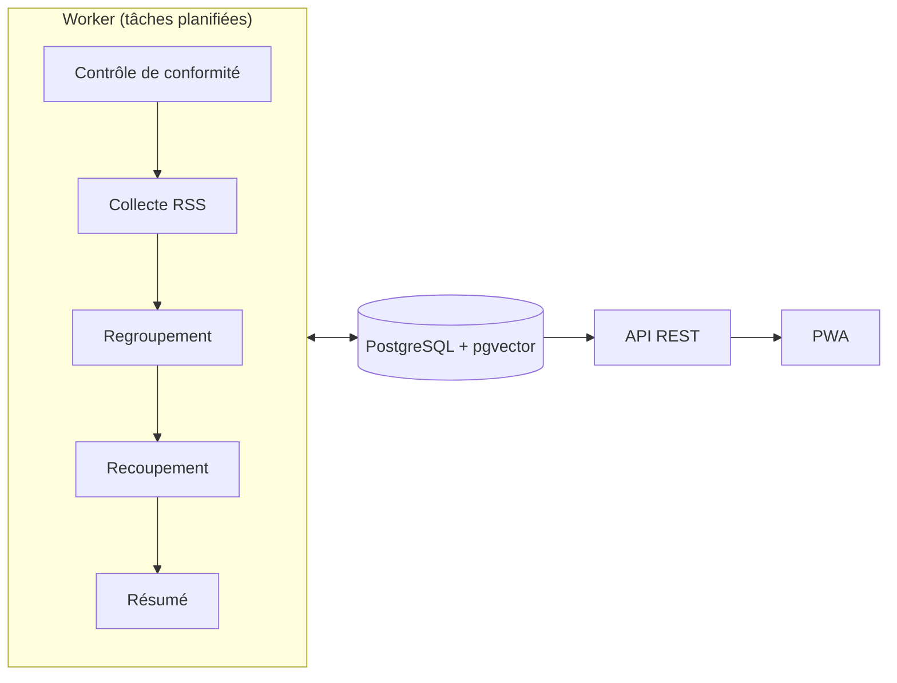

# Sourcé

> Les faits du jour, chacun avec ses sources.

Sourcé est une application web qui présente chaque jour les événements les plus couverts par la presse, en n'affichant que des informations vérifiables : chaque phrase de résumé renvoie aux articles qui l'appuient, chaque événement indique s'il est confirmé par au moins deux sources indépendantes, et le choix des médias qui refusent l'analyse automatique de leurs contenus est respecté.

**État : V1 fonctionnelle en local** (collecte, regroupement, recoupement, résumés, API et interface) ; déploiement à venir.

## Principes

- **Pas de source, pas d'affichage** : chaque information renvoie à au moins un article cliquable.
- **Recoupement** : un événement est « confirmé » à partir de deux origines indépendantes, sinon il est marqué « source unique ».
- **Faits et opinions séparés** : tribunes, éditoriaux et contenus sponsorisés sont écartés.
- **Résumés neutres** : chiffres et citations vérifiés automatiquement dans les sources ; « informations insuffisantes » plutôt qu'une invention.
- **Droits d'auteur** : titre, résumé reformulé et lien, jamais l'article lui-même.
- **Conformité** : robots.txt et réserves de fouille de textes (TDM) contrôlés chaque jour pour chaque source.

## Fonctionnement



## Stack technique

| Couche | Choix |
|---|---|
| Interface | React, Vite, Tailwind CSS, PWA installable |
| API | Node.js, Express, TypeScript, validation zod |
| Données | PostgreSQL 17, pgvector, Drizzle ORM |
| Traitement | worker planifié (node-cron), embeddings multilingues calculés localement (transformers.js), API Claude pour les résumés |
| Qualité | Vitest, ESLint, Prettier, GitHub Actions |

## Démarrage

Prérequis : Node.js 22 et Docker.

```bash
npm install
cp .env.example .env      # puis compléter les valeurs
npm run db:up             # PostgreSQL 17 + pgvector en local
npm run db:migrate
npm run db:seed           # thèmes, zones, sources et flux
npm run check             # lint, format, types et tests
```

Worker (contrôle de conformité quotidien, collecte horaire) :

```bash
npm run compliance -w @sourcee/worker   # contrôle des sources, une fois
npm run collect -w @sourcee/worker      # collecte des flux, une fois
npm run cluster -w @sourcee/worker      # regroupement en événements et recoupement
npm run summarize -w @sourcee/worker    # résumés (nécessite ANTHROPIC_API_KEY)
npm run start -w @sourcee/worker        # planificateur (tâches automatiques)
```

API REST (port `API_PORT`, 3000 par défaut) et interface :

```bash
npm run dev -w @sourcee/api             # API : http://localhost:3000/api/events
npm run dev -w @sourcee/web             # interface : http://localhost:5173
```

En production, l'API sert l'interface construite :

```bash
npm run build -w @sourcee/web
npm run start -w @sourcee/api           # http://localhost:3000
```

## Documentation

- [Architecture](docs/architecture.md) : règles produit, niveaux d'usage des sources, étapes du traitement, API.
- [Modèle de données](docs/modele-donnees.md) : schéma entité-association, index, exemple de réponse de l'API.
- [Maquette interactive](docs/maquette.html) : à ouvrir dans un navigateur après avoir cloné le dépôt.

## Feuille de route

- [x] Comparatif des sources et architecture
- [x] Modèle de données et maquette
- [x] Initialisation du dépôt
- [x] Contrôle de conformité et collecte RSS
- [x] Regroupement des articles et recoupement
- [x] Résumés sourcés
- [x] API REST
- [x] Interface PWA
- [ ] Déploiement (hébergeur à choisir)

Notifications : non prévues dans la V1.

## Auteur

Théo Celebi — [github.com/TheoCelebi](https://github.com/TheoCelebi)
