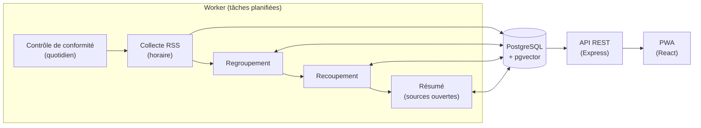

# Architecture

Sourcé publie chaque jour les dix événements les plus couverts par la presse, avec leur statut de recoupement, un résumé neutre quand les sources le permettent, et toujours les liens vers les articles d'origine.

## Règles produit

| # | Règle | Mise en œuvre |
|---|---|---|
| 1 | Pas de source, pas d'affichage | L'API ne renvoie un événement que s'il a au moins un article. Chaque phrase de résumé cite les articles qui l'appuient ; une phrase sans source est supprimée. |
| 2 | Recoupement | `confirmé` à partir de deux origines indépendantes, sinon `source unique`, affiché sur la carte. |
| 3 | Faits et opinions séparés | Tribunes, éditoriaux, chroniques et contenus sponsorisés sont détectés à la collecte (URL, catégories du flux, mentions dans le titre) et écartés. |
| 4 | Résumés neutres | Consignes de style, puis contrôles automatiques : chaque nombre doit figurer dans un article cité ; une citation entre guillemets doit être reprise mot pour mot d'une source francophone, sinon elle passe au discours indirect attribué. |
| 5 | Aucune invention | Moins de deux phrases sourcées valides : l'événement affiche « Informations insuffisantes ». |
| 6 | Droits d'auteur | Seuls le titre de l'article, le résumé reformulé et le lien sont affichés. Les chapôs servent au traitement interne et ne sont jamais affichés. |
| 7 | Conditions des sources | Contrôle quotidien de robots.txt et des réserves de fouille de textes, requêtes conditionnelles, au plus une requête par flux et par heure. |

## Vue d'ensemble



## Sources et niveaux d'usage

Le 17 novembre 2026, le contrôle des 14 sources retenues à l'étape 1 a donné :

- les 12 médias bloquent au moins un robot d'IA (ClaudeBot, GPTBot, CCBot…) dans le robots.txt de leur domaine principal ;
- franceinfo et Le Figaro ont en plus posé une réserve formelle de fouille de textes et de données (fichier TDMRep ou en-tête `tdm-reservation`), au sens de l'article 4 de la directive (UE) 2019/790 ;
- seules les deux sources officielles (ONU Info, Commission européenne) n'ont aucune restriction.

Le niveau d'usage de chaque source est donc calculé automatiquement, jamais fixé à la main :

| Niveau | Condition | Ce que Sourcé en fait |
|---|---|---|
| `open` | aucun robot d'IA bloqué, aucune réserve TDM | regroupement, recoupement, envoi du titre et du chapô au modèle de résumé |
| `links_only` | au moins un robot d'IA bloqué sur le domaine principal | titre et lien seulement, rapprochement local des titres, prise en compte dans le recoupement ; jamais envoyé au modèle, chapô non conservé |
| `excluded` | réserve TDM, ou flux interdit par robots.txt | non collecté |

Si une source perd le niveau `open`, ses chapôs déjà stockés sont effacés.

### Sources de la V1

Le catalogue complet (flux, langue, groupe, thème et zone par défaut) est dans [`packages/db/src/catalog.ts`](../packages/db/src/catalog.ts). Résultat du premier contrôle automatique, le 17 novembre 2026 :

| Niveau | Sources | Motif |
|---|---|---|
| `open`, institutions | Commission européenne, Parlement européen, Banque centrale européenne, Insee | aucune réserve |
| `open`, médias | Public Sénat, Africanews, Global Voices, Voice of America, CNA, South China Morning Post | aucune réserve |
| `links_only` | BBC, Le Monde, The Guardian, DW, Al Jazeera, NPR, Euronews, Libération | robots d'IA bloqués |
| `excluded` | franceinfo, Le Figaro, France 24, RFI | réserve TDM (fichier tdmrep.json ou en-tête) |
| `excluded` | ONU Info, RFE/RL | flux interdit par robots.txt (`*/news/`, `/api/*`) |

Le contrôle automatique est plus fiable qu'un relevé manuel : le pare-feu de France 24 et de RFI renvoie une page « Access denied » à certains clients HTTP, ce qui masquait leur fichier tdmrep.json lors du premier relevé fait à la main.

Sans restriction mais sans flux RSS trouvé à ce jour, et donc absents de la V1 : info.gouv.fr, vie-publique.fr, Élysée, Assemblée nationale, Sénat, Banque de France, ministère de l'Europe et des Affaires étrangères, OCDE, Unicef, HCR, Arte.

### Indépendance

Deux articles ont la même origine s'ils viennent du même groupe de presse ou reprennent la même dépêche d'agence. Exemples : France 24 et RFI (France Médias Monde), Voice of America et RFE/RL (USAGM), Euronews et Africanews.

Les sources officielles sont affichées comme sources primaires mais ne comptent pas dans le recoupement : une institution qui s'exprime sur ses propres actes n'est pas une confirmation indépendante.

### GDELT

Retiré de la V1 : l'API DOC 2.0 a renvoyé une erreur 429 à chaque essai, les 16 et 17 novembre 2026, même avec une requête toutes les 7 secondes. Piste pour plus tard : ses fichiers bruts (GKG), pour reconstituer l'historique antérieur au lancement.

## Étapes du traitement

### Contrôle de conformité (tous les jours)

- robots.txt du domaine principal : flux autorisé ? robots d'IA bloqués (ClaudeBot, anthropic-ai, GPTBot, CCBot, Google-Extended) ?
- `/.well-known/tdmrep.json` et en-tête `tdm-reservation`.
- Résultat historisé dans `policy_checks`, niveau d'usage mis à jour.

### Collecte (toutes les heures)

- Requêtes conditionnelles (`If-None-Match`, `If-Modified-Since`), délai maximal de 15 s, User-Agent configurable (`COLLECTOR_USER_AGENT`).
- Normalisation de l'URL (paramètres `utm_*` et fragments retirés), dédoublonnage par URL puis par GUID.
- Classement du contenu (`news`, `opinion`, `sponsored`) et détection d'agence (« avec AFP », « (Reuters) »…).
- Sources `links_only` : seuls le titre, l'URL et la date sont conservés.
- Journal de chaque passage dans `fetch_runs`.

### Regroupement

- Embedding multilingue du titre, calculé localement (transformers.js, modèle `paraphrase-multilingual-MiniLM-L12-v2` quantifié, 384 dimensions, stocké dans pgvector) : rien n'est envoyé à un service tiers.
- Regroupement hiérarchique ascendant en lien moyen (UPGMA), journée par journée (fuseau Europe/Paris) : deux groupes fusionnent si la similarité cosinus moyenne entre leurs titres atteint 0,65 et si aucune paire de titres ne descend sous 0,5, ce qui empêche l'enchaînement de sujets voisins.
- Les événements déjà formés sont figés : ils accueillent les nouveaux articles qui leur ressemblent, mais ne fusionnent jamais entre eux, pour que leur identifiant et leur résumé restent stables d'une heure à l'autre.
- Calibration, faite le 17 novembre 2026 sur 440 titres réels : un rattachement au centroïde (seuils 0,62 à 0,74) fusionnait des événements distincts (vote du Sénat sur les retraites et réforme présentée par une candidate) ; le lien moyen avec similarité minimale les sépare. Le modèle `multilingual-e5-small`, essayé à titre de comparaison, ne séparait pas mieux les cas difficiles.

Limites connues :

- À partir des seuls titres, la similarité capte le sujet plus que l'événement ; deux faits voisins publiés le même jour peuvent se retrouver ensemble.
- Le modèle rapproche plus facilement deux titres d'une même langue : un événement couvert en français et en anglais peut former deux groupes. L'API replie ces doublons dans le classement du jour.
- Le statut « confirmé » reste prudent : il exige deux origines indépendantes à l'intérieur d'un même groupe.

### Recoupement et classement

- Origine d'un article : l'agence détectée, sinon le groupe de la source.
- `independent_origins` : nombre d'origines distinctes parmi les articles `news` des médias.
- Score du jour : `10 × origines indépendantes + log2(1 + nombre d'articles)` ; les dix premiers forment l'édition.
- Thèmes et zones d'un événement sans résumé : indices partagés par une majorité stricte de ses articles (deux au plus).
- Titre d'un événement sans résumé : celui de l'article le plus proche du centre du groupe, affiché comme titre d'origine attribué.

### Résumé

- Claude Haiku 5.5, effort `low`, sortie structurée validée par zod. Deux accès, choisis par `SUMMARY_PROVIDER` :
  - l'API, via le SDK officiel `@anthropic-ai/sdk`, avec la clé de `.env` : la voie d'un site public ;
  - Claude Code en mode non interactif (`claude -p --json-schema …`), sur l'abonnement de la personne connectée, pour un usage personnel. Aucun outil n'est autorisé, la session n'est pas enregistrée, deux appels au plus à la fois.
- Par défaut (`auto`) : l'API si une clé existe, sinon Claude Code s'il est installé. Sans aucun accès, l'étape se limite à marquer les événements sans source ouverte.
- Événements concernés : les 60 premiers de chaque journée, sur deux jours.
- Entrée : titres et chapôs des seuls articles `open` de l'événement (8 au plus), numérotés. Les titres des sources `links_only` ne sont jamais envoyés au modèle, ce que vérifie un test d'intégration.
- Sortie structurée (JSON Schema) : titre neutre, 2 à 4 phrases avec les numéros des articles cités, thèmes et zones choisis dans des listes fermées, ou `insufficient`.
- Contrôles déterministes après génération : numéros valides, nombres présents dans les sources citées, citations reprises mot pour mot. Une phrase qui échoue est retirée.
- Nouvel appel seulement quand de nouveaux articles `open` rejoignent l'événement (ou une heure après une erreur) ; chaque version est historisée dans `summaries` (modèle, version du prompt, phrases rejetées et motif, jetons consommés).
- Un refus du modèle ou une erreur d'API n'efface pas un résumé valide déjà publié ; une clé refusée, Claude Code déconnecté ou introuvable interrompent la série.
- Événement sans source `open` : aucun appel au modèle. La carte affiche le titre d'origine, attribué, et les liens ; le thème et la zone viennent des catégories des flux.

### API

Express 5, paramètres validés par zod, messages d'erreur en français, cache HTTP d'une minute. Les types de réponse sont partagés avec l'interface (`packages/shared/src/api.ts`).

| Route | Rôle |
|---|---|
| `GET /api/events?from=&to=&themes=&zones=&q=&limit=` | Édition d'une journée ou d'une période (31 jours au plus), `limit` événements par journée (10 par défaut). `themes` et `zones` acceptent plusieurs valeurs séparées par des virgules ; filtrer sur l'Europe inclut la France. `q` cherche chaque mot comme préfixe, sans accents, dans les titres et résumés. |
| `GET /api/events/:id` | Un événement. |
| `GET /api/sources` | Sources, niveau d'usage et preuve du dernier contrôle de conformité. |
| `GET /api/stats?day=` | Coulisses de l'édition : événements, confirmés, articles, tribunes et contenus sponsorisés écartés. |
| `GET /api/themes`, `GET /api/zones` | Listes fermées des filtres. |
| `GET /api/health` | État du service et de la base. |

Garanties appliquées par l'API :

- **Pas de source, pas d'affichage :** les articles des sources exclues ne sont jamais renvoyés ; un événement sans article affichable disparaît, tout comme une phrase de résumé dont aucune source n'est affichable.
- **Repli des doublons :** dans le classement du jour, un événement dont le centroïde ressemble (cosinus ≥ 0,78) à celui d'un événement mieux classé, ou d'un groupe déjà replié sous lui, est replié sous ce dernier (champ `related`). Le seuil a été calibré sur les données du 17 novembre 2026 : les doublons observés dépassaient 0,79, un événement distinct mais voisin atteignait 0,754.

### Front

- React 19, Vite 8 et Tailwind CSS 4 ; données chargées avec TanStack Query ; types de l'API partagés avec le serveur.
- PWA installable : le service worker précache l'application et les polices, et garde en cache la dernière édition consultée (stratégie « réseau d'abord »).
- Polices Newsreader et Inter auto-hébergées : aucune requête vers un service tiers.
- Pages : édition du jour (filtres par date ou période, thèmes, zones, mot-clé, tous reflétés dans l'URL), méthodologie, sources et conformité.
- Mode « 1 minute », frise de la journée, thèmes clair et sombre, appels de note vers les sources de chaque phrase.
- Les couleurs et typographies de la [maquette](maquette.html) sont les jetons du thème Tailwind (`apps/web/src/styles.css`).
- En production, l'API sert aussi l'interface construite (un seul service à déployer), avec une politique de sécurité de contenu stricte.

## Organisation du code

```
apps/
  api/      Express : routes, validation, cache HTTP
  worker/   conformité, collecte, regroupement, résumés (node-cron)
  web/      React + Vite + Tailwind (PWA)
packages/
  db/       schéma Drizzle, migrations, données de référence
docs/       architecture, modèle de données, maquette
```

TypeScript partout, npm workspaces, tests Vitest, ESLint et Prettier, intégration continue GitHub Actions. En local : PostgreSQL 17 et pgvector via Docker (`pgvector/pgvector:pg17`).

## Hors périmètre de la V1

- Notifications et comptes utilisateurs.
- Historique antérieur au premier jour de collecte.
