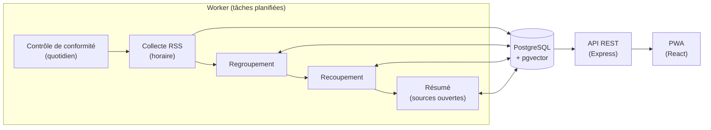

# Architecture

Sourcé publie chaque jour les dix événements les plus couverts par la presse, avec leur statut de recoupement, un résumé neutre quand les sources le permettent, et toujours les liens vers les articles d'origine.

## Règles produit

| # | Règle | Mise en œuvre |
|---|---|---|
| 1 | Pas de source, pas d'affichage | L'API ne renvoie un événement que s'il a au moins un article. Chaque phrase de résumé cite les articles qui l'appuient ; une phrase sans source est supprimée. |
| 2 | Recoupement | `confirmé` à partir de deux origines indépendantes, sinon `source unique`, affiché sur la carte. |
| 3 | Faits et opinions séparés | Tribunes, éditoriaux, chroniques et contenus sponsorisés sont détectés à la collecte (URL, catégories du flux, mentions dans le titre) et écartés. |
| 4 | Résumés neutres | Consignes de style, puis contrôles automatiques : chaque nombre doit figurer dans un article cité ; une citation entre guillemets doit être reprise mot pour mot d'une source francophone, sinon elle passe au discours indirect attribué. |
| 5 | Aucune invention | Moins de deux phrases sourcées valides : l'événement affiche « Informations insuffisantes ». |
| 6 | Droits d'auteur | Seuls le titre de l'article, le résumé reformulé et le lien sont affichés. Les chapôs servent au traitement interne et ne sont jamais affichés. |
| 7 | Conditions des sources | Contrôle quotidien de robots.txt et des réserves de fouille de textes, requêtes conditionnelles, au plus une requête par flux et par heure. |

## Vue d'ensemble



## Sources et niveaux d'usage

Le 17 novembre 2026, le contrôle des 14 sources retenues à l'étape 1 a donné :

- les 12 médias bloquent au moins un robot d'IA (ClaudeBot, GPTBot, CCBot…) dans le robots.txt de leur domaine principal ;
- franceinfo et Le Figaro ont en plus posé une réserve formelle de fouille de textes et de données (fichier TDMRep ou en-tête `tdm-reservation`), au sens de l'article 4 de la directive (UE) 2019/790 ;
- seules les deux sources officielles (ONU Info, Commission européenne) n'ont aucune restriction.

Le niveau d'usage de chaque source est donc calculé automatiquement, jamais fixé à la main :

| Niveau | Condition | Ce que Sourcé en fait |
|---|---|---|
| `open` | aucun robot d'IA bloqué, aucune réserve TDM | regroupement, recoupement, envoi du titre et du chapô au modèle de résumé |
| `links_only` | au moins un robot d'IA bloqué sur le domaine principal | titre et lien seulement, rapprochement local des titres, prise en compte dans le recoupement ; jamais envoyé au modèle, chapô non conservé |
| `excluded` | réserve TDM, ou flux interdit par robots.txt | non collecté |

Si une source perd le niveau `open`, ses chapôs déjà stockés sont effacés.

### Sources de la V1

Le catalogue complet (flux, langue, groupe, thème et zone par défaut) est dans [`packages/db/src/catalog.ts`](../packages/db/src/catalog.ts). Niveaux attendus d'après le constat du 17 novembre 2026 :

| Niveau attendu | Sources |
|---|---|
| `open`, institutions | ONU Info, Commission européenne, Parlement européen, Banque centrale européenne, Insee |
| `open`, médias | Public Sénat, Africanews, Global Voices, Voice of America, RFE/RL, CNA, South China Morning Post |
| `links_only` | BBC, Le Monde, France 24, RFI, The Guardian, DW, Al Jazeera, NPR, Euronews, Libération |
| `excluded` | franceinfo, Le Figaro |

Sans restriction mais sans flux RSS trouvé à ce jour, et donc absents de la V1 : info.gouv.fr, vie-publique.fr, Élysée, Assemblée nationale, Sénat, Banque de France, ministère de l'Europe et des Affaires étrangères, OCDE, Unicef, HCR, Arte.

### Indépendance

Deux articles ont la même origine s'ils viennent du même groupe de presse ou reprennent la même dépêche d'agence. Exemples : France 24 et RFI (France Médias Monde), Voice of America et RFE/RL (USAGM), Euronews et Africanews.

Les sources officielles sont affichées comme sources primaires mais ne comptent pas dans le recoupement : une institution qui s'exprime sur ses propres actes n'est pas une confirmation indépendante.

### GDELT

Retiré de la V1 : l'API DOC 2.0 a renvoyé une erreur 429 à chaque essai, les 16 et 17 novembre 2026, même avec une requête toutes les 7 secondes. Piste pour plus tard : ses fichiers bruts (GKG), pour reconstituer l'historique antérieur au lancement.

## Étapes du traitement

### Contrôle de conformité (tous les jours)

- robots.txt du domaine principal : flux autorisé ? robots d'IA bloqués (ClaudeBot, anthropic-ai, GPTBot, CCBot, Google-Extended) ?
- `/.well-known/tdmrep.json` et en-tête `tdm-reservation`.
- Résultat historisé dans `policy_checks`, niveau d'usage mis à jour.

### Collecte (toutes les heures)

- Requêtes conditionnelles (`If-None-Match`, `If-Modified-Since`), délai maximal de 15 s, User-Agent configurable (`COLLECTOR_USER_AGENT`).
- Normalisation de l'URL (paramètres `utm_*` et fragments retirés), dédoublonnage par URL puis par GUID.
- Classement du contenu (`news`, `opinion`, `sponsored`) et détection d'agence (« avec AFP », « (Reuters) »…).
- Sources `links_only` : seuls le titre, l'URL et la date sont conservés.
- Journal de chaque passage dans `fetch_runs`.

### Regroupement

- Embedding multilingue du titre, calculé localement (transformers.js, modèle de type `paraphrase-multilingual-MiniLM-L12-v2`, 384 dimensions) : rien n'est envoyé à un service tiers.
- Rattachement à l'événement le plus proche du même jour (fuseau Europe/Paris), en comparant l'embedding de l'article aux centroïdes des événements (opérateur de distance cosinus de pgvector), si la similarité dépasse un seuil calibré sur des données réelles ; sinon, création d'un événement.

### Recoupement et classement

- Origine d'un article : l'agence détectée, sinon le groupe de la source.
- `independent_origins` : nombre d'origines distinctes parmi les articles `news` des médias.
- Score du jour calculé à partir des origines indépendantes, du nombre d'articles et de la fraîcheur ; les dix premiers forment l'édition.

### Résumé

- Claude Haiku 5.5 via le SDK officiel `@anthropic-ai/sdk` ; clé dans `.env`.
- Entrée : titres et chapôs des seuls articles `open` de l'événement, numérotés.
- Sortie structurée (JSON Schema) : titre neutre, 2 à 4 phrases avec les numéros des articles cités, thèmes et zones choisis dans des listes fermées, ou `insufficient`.
- Contrôles déterministes après génération : numéros valides, nombres présents dans les sources citées, citations reprises mot pour mot. Une phrase qui échoue est retirée.
- Nouvel appel seulement quand de nouveaux articles `open` rejoignent l'événement ; chaque version est historisée dans `summaries` (modèle, version du prompt, jetons consommés).
- Événement sans source `open` : aucun appel au modèle. La carte affiche le titre d'origine, attribué, et les liens ; le thème et la zone viennent des catégories des flux.

### API

- `GET /api/events?from=&to=&themes=&zones=&q=&limit=` : validation des paramètres (zod), top 10 par jour par défaut.
- `GET /api/events/:id`
- `GET /api/themes`, `GET /api/zones`, `GET /api/sources` (niveau d'usage et date du dernier contrôle)
- `GET /api/health`

### Front

- PWA React (Vite) et Tailwind ; dernière édition consultable hors ligne.
- Pages : édition du jour, méthodologie, sources et conformité.
- Mode « 1 minute », frise chronologique, thèmes clair et sombre.
- Les couleurs et typographies de la [maquette](maquette.html) deviennent les jetons du thème Tailwind.

## Organisation du code

```
apps/
  api/      Express : routes, validation, cache HTTP
  worker/   conformité, collecte, regroupement, résumés (node-cron)
  web/      React + Vite + Tailwind (PWA)
packages/
  db/       schéma Drizzle, migrations, données de référence
docs/       architecture, modèle de données, maquette
```

TypeScript partout, npm workspaces, tests Vitest, ESLint et Prettier, intégration continue GitHub Actions. En local : PostgreSQL 17 et pgvector via Docker (`pgvector/pgvector:pg17`).

## Hors périmètre de la V1

- Notifications et comptes utilisateurs.
- Historique antérieur au premier jour de collecte.
