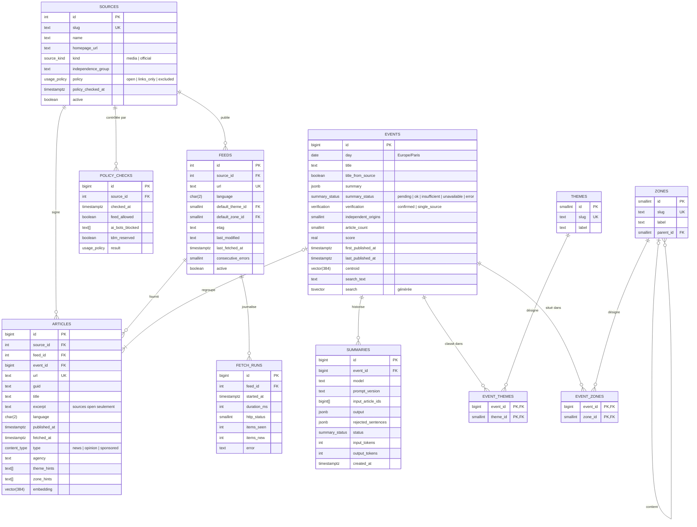

# Modèle de données

PostgreSQL 17 avec les extensions `vector` (pgvector) et `unaccent`. Le schéma est écrit avec Drizzle ORM ([`packages/db/src/schema.ts`](../packages/db/src/schema.ts)) ; les migrations sont versionnées dans `packages/db/drizzle`.

## Diagramme entité-association



## Rôle des tables

| Table | Rôle | Points d'attention |
|---|---|---|
| `sources` | Un média ou une institution. | `independence_group` sert de clé d'indépendance ; `policy` vaut `excluded` jusqu'au premier contrôle de conformité, puis il est recalculé chaque jour. |
| `policy_checks` | Historique des contrôles robots.txt et TDMRep. | Garde la preuve de chaque décision de niveau d'usage. |
| `feeds` | Un flux RSS d'une source. | `etag` et `last_modified` pour les requêtes conditionnelles ; thème et zone par défaut déduits de la rubrique du flux. |
| `fetch_runs` | Journal de chaque collecte. | Sert au suivi des erreurs et des volumes. |
| `articles` | Un article vu dans un flux. | `url` canonique unique ; `excerpt` vide pour les sources `links_only` ; `theme_hints` et `zone_hints` viennent de l'URL et des catégories du flux ; `embedding` calculé sur le titre seul. |
| `events` | Un événement d'une journée. | `summary` est un tableau de phrases sourcées ; `search` est une colonne générée (sans accents) à partir de `search_text`, qui réunit titre, résumé et titres des articles. |
| `summaries` | Chaque génération de résumé. | Modèle, version du prompt, articles fournis, phrases rejetées par les contrôles, jetons consommés. |
| `themes`, `zones` | Listes fermées utilisées par les filtres. | `zones.parent_id` : France est rattachée à Europe. |

## Règles calculées

- **Origine d'un article** : `articles.agency` si une agence est détectée, sinon `sources.independence_group`.
- **`events.independent_origins`** : nombre d'origines distinctes parmi les articles `news` des sources `media`. Les sources officielles ne comptent pas.
- **`events.verification`** : `confirmed` si `independent_origins >= 2`, sinon `single_source`.
- **`events.summary`** : `[{ "text": "…", "articleIds": [12, 15] }]`. Chaque phrase cite au moins un article d'une source `open` rattaché à l'événement ; il faut 2 à 4 phrases valides, sinon `summary_status = insufficient`.
- **`events.summary_status = unavailable`** : l'événement n'a aucune source `open` ; aucun appel au modèle, `title_from_source = true`.
- **`events.score`** : classement du top 10 du jour, calibré à l'étape 4b.

## Index

| Index | Usage |
|---|---|
| `articles (url)` unique | dédoublonnage |
| `articles (published_at DESC)` | collecte et regroupement récents |
| `articles (event_id)` | articles d'un événement |
| `events (day, score DESC)` | édition du jour |
| `events USING gin (search)` | recherche par mot-clé |
| `event_themes (theme_id)`, `event_zones (zone_id)` | filtres |

Le regroupement compare un article aux centroïdes des événements du même jour, soit quelques centaines de vecteurs au plus. Un parcours exact suffit : un index approximatif (HNSW) n'apporterait rien à cette échelle.

## Données de référence

- **Thèmes** : international, politique, économie, science, tech, sport, environnement, santé, société, culture.
- **Zones** : monde (portée mondiale), Europe (dont France), Afrique, Amériques, Asie-Pacifique, Moyen-Orient. Filtrer sur Europe inclut les événements situés en France.

## Exemple de réponse de l'API

`GET /api/events?from=2026-11-17&to=2026-11-17&limit=10` (données fictives, extrait) :

```json
{
  "from": "2026-11-17",
  "to": "2026-11-17",
  "events": [
    {
      "id": 1842,
      "rank": 1,
      "title": "Conférence sur les océans : 52 États adoptent un accord sur la pêche en haute mer",
      "titleFromSource": false,
      "verification": "confirmed",
      "independentOrigins": 4,
      "articleCount": 6,
      "themes": ["environnement"],
      "zones": ["monde"],
      "firstPublishedAt": "2026-11-17T06:42:00Z",
      "updatedAt": "2026-11-17T15:10:00Z",
      "summary": {
        "status": "ok",
        "sentences": [
          {
            "text": "Selon le secrétariat de la conférence, 52 États ont adopté mardi un accord encadrant la pêche dans les eaux internationales.",
            "articleIds": [90311]
          }
        ]
      },
      "articles": [
        {
          "id": 90311,
          "source": { "name": "Secrétariat de la conférence des océans", "kind": "official", "policy": "open" },
          "title": "Adoption par 52 États de l'accord sur la pêche en haute mer",
          "url": "https://exemple.org/communique",
          "language": "fr",
          "publishedAt": "2026-11-17T06:42:00Z",
          "agency": null,
          "usedInSummary": true
        }
      ]
    }
  ]
}
```
